# @u1in/shushi

@u1in/shushi 是一个基于 Vite、Vue 与 Tailwind CSS 的多包工作区，用于把加法、减法、乘法、除法和短除法的计算过程转换为可编辑、可渲染的竖式网格。

项目面向教学、调试和前端集成，支持两种输入方式：人工录入网格宏源码，或输入数值让计算器自动填写同一种宏源码。两者都会经过同一个宏编译器，生成统一的 `GridScene`，再由 DOM/CSS 或 SVG 渲染器输出。

> [在线演示](https://demo.example.com/shushi) · [在线文档](https://docs.example.com/shushi)
>
> 上述地址为部署占位链接，发布正式站点后只需替换 URL。

## 快速开始

安装面向 npm 使用者的统一运行时入口：

```bash
npm install @u1in/shushi-core
```

几行代码即可得到一个可渲染的竖式：

```ts
import {
  computeAddition,
  createAdditionMacroSource,
  compileMacro,
  renderDomGrid,
} from '@u1in/shushi-core'

// 计算层：只生成与渲染无关的逐列过程
const computation = computeAddition('356', '278')
// 布局层：把计算过程填写为可编辑的宏源码
const source = createAdditionMacroSource(computation)
// 宏编译层：统一生成渲染器消费的 GridScene
const scene = compileMacro(source)
// 渲染层：把同一份 GridScene 转为 DOM 舞台
const stage = renderDomGrid(scene)

document.querySelector('#result')?.append(stage)
```

上面的示例会渲染 `356 + 278 = 634` 的竖式过程。除 `renderDomGrid` 外，也可以使用 `renderSvgGrid` 输出 SVG。

## 项目链路



计算规则不进入渲染器：计算层只负责生成运算过程和语义数据，宏编译器负责把公开宏命令转换为 `GridScene`，渲染器只消费这一份统一场景契约。

## 当前能力

- 多种运算过程：覆盖加法、减法、乘法、除法和短除法，并保留进位、借位、余数等教学过程。
- 人工录入与宏编译：人工源码和计算器自动生成的源码经过同一个宏编译器。
- 加法、减法、乘法、除法：提供逐位计算、部分过程、进位/借位、商和余数等结果数据。
- 短除法：支持质因数分解与约数信息、最大公约数/最小公倍数，以及十进制转 2–36 进制。
- 统一 `GridScene`：用与运算无关的轨道、单元格、文字、边线和语义样式 token 描述网格。
- 双渲染器：同一份场景可渲染为绝对定位的 DOM/CSS 或 SVG，适应文档和应用页面。
- Web 演示：提供计算器、网格宏试验区、AST 元素检查器和 DOM/SVG 竖式预览；文档与竖式元素命名图谱统一由 VuePress 文档站维护。

## 工作区结构

| 包 | 职责 |
| --- | --- |
| `@u1in/shushi-grid` | 通用行列网格类型与轨道几何 |
| `@u1in/shushi-calculators` | 各类竖式运算的计算过程与结果类型 |
| `@u1in/shushi-layout` | 根据计算结果组织竖式结构并生成宏源码 |
| `@u1in/shushi-renderers` | DOM/CSS 与 SVG 渲染器 |
| `@u1in/shushi-macro` | 网格宏语言解析、编译与 `GridScene` 生成 |
| `@u1in/shushi-macro-docs` | 宏文档 Vue 展示组件、图例与样式 |
| `@u1in/shushi-docs` | 框架无关的宏说明、技术文档与图例文档源 |
| `@u1in/shushi-docs-site` | VuePress 文档发布适配层与交互组件注册 |
| `@u1in/shushi-web` | Vue 首页演示、主题和交互组件 |
| `@u1in/shushi-core` | 面向 npm 使用者的计算、布局、宏编译、网格和渲染统一入口 |

面向 npm 使用者的公共能力统一从 `@u1in/shushi-core` 导入。`@u1in/shushi-calculators`、`@u1in/shushi-layout` 等领域包仍保留，供需要细粒度依赖边界的场景使用。

## Bug 反馈与贡献

请通过 [GitHub Issues](https://github.com/u1in/shushi/issues) 反馈 Bug 或提出功能建议。提交问题时请尽量附上复现步骤、输入数据、预期结果、实际结果，以及相关浏览器或 Node.js 版本。

涉及计算规则、布局规则、网格契约或渲染行为的改动，请同步更新所属中文规则文档和测试，并在提交前运行 `npm run typecheck`、`npm run test` 与 `npm run build`。

提交说明使用 Conventional Commits 格式：`<type>(<scope>): <中文说明>`，例如：

```text
feat(web): 增加竖式过程预览
```

## 作者

u1in <u1in@qq.com>
