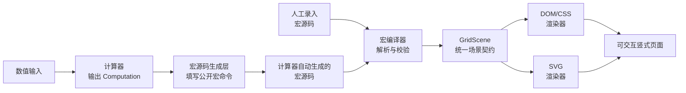

# @u1in/shushi-core

把竖式计算过程接入网页或 Node.js 应用：输入运算数据，得到可编辑的宏源码，编译为统一的 `GridScene`，再渲染为 DOM/CSS 或 SVG。

> 人工录入和计算器自动填写的是同一种宏源码，并经过同一条编译链路得到竖式。
>
> [在线文档](https://u1in.github.io/shushi/) · [在线演示](https://u1in.github.io/shushi/demo/)

## 安装

一般应用只需要安装统一入口 `@u1in/shushi-core`。它同时提供计算器、竖式布局、宏解析与编译、网格工具以及 DOM/SVG 渲染器，并自带 TypeScript 类型声明。

### npm 安装

```bash
npm install @u1in/shushi-core
```

### Skill 安装

在目标项目中执行，安装到当前 Agent 环境：

```bash
npx skills add https://github.com/u1in/shushi/tree/main/skills/shushi-core -a codex -y
```

### AI 安装指令

将下面的指令复制到你的代码 Agent 对话框：

```text
请阅读并严格遵循 https://u1in.github.io/shushi/agent-installation.md 的内容，并按以下要求执行：
- 在当前项目根目录操作。
- 使用项目现有的包管理器安装并验证 @u1in/shushi-core。
- 保留现有依赖、配置和锁文件改动。
- 不要擅自安装或切换 Node.js、registry 或包管理器。
- 不要覆盖或回滚用户文件。
- 如果文档无法访问或安装受阻，先说明原因。
- 完成后汇报实际执行的命令、版本和验证结果。
```

## 使用

### 源代码实现

下面的链路会把 `356 + 278` 计算、排版并显示为 DOM 竖式：

```ts
import {
  compileMacro,
  computeAddition,
  createAdditionMacroSource,
  renderDomGrid,
} from '@u1in/shushi-core'
import '@u1in/shushi-core/style.css'

// 计算层：输出答案、进位和逐列过程，不关心页面如何绘制。
const computation = computeAddition('356', '278')

// 布局层：把计算过程填写为可编辑的网格宏源码。
const source = createAdditionMacroSource(computation)

// 编译层：把宏源码转换为统一的 GridScene。
const scene = compileMacro(source)

// 渲染层：将同一份 GridScene 转为 DOM 舞台。
const stage = renderDomGrid(scene)
document.querySelector('#result')?.append(stage)
```

如果需要 SVG，把最后一步替换为：

```ts
import { renderSvgGrid } from '@u1in/shushi-core'

const stage = renderSvgGrid(scene)
document.querySelector('#result')?.append(stage)
```

### Skill 实现

安装 Skill 后，将下面的指令复制到你的代码 Agent：

```text
$shushi-core 请使用 @u1in/shushi-core 完成 356 + 278 的竖式：生成可编辑宏源码，编译为 GridScene，并渲染为 DOM。请说明使用的 API 和结果。
```

### AI 实现

将下面的指令复制到代码 Agent，并按需替换输入数据：

```text
请先阅读并理解 https://u1in.github.io/shushi/agent-capabilities.md 的完整内容，然后直接实现下面这组输入数据对应的竖式，不要先询问用户：
- 输入数据：356 + 278
- 根据输入数据中的运算符自动识别运算类型，自行计算并校验结果，不要求用户填写运算类型或期望结果。
- 根据这行输入表达式直接执行，并选择对应的计算器、竖式布局、宏编译、GridScene、播放或 DOM/SVG 渲染能力。
- 如果没有说明渲染目标或渲染模式，先询问要接入哪个页面或容器，以及使用 DOM/CSS 还是 SVG；其他参数按文案直接执行。
- 保持计算层、布局层、GridScene 与渲染器的职责边界，不要把运算规则写进通用渲染器。
- 修改代码时遵守项目自身的 AGENTS.md，必要时同步更新技术文档、测试和示例。
- 除渲染目标和渲染模式外，不要重复询问已经给出的参数；完成后说明实现内容、涉及文件和验证结果。
```

## 选择合适的 API

| 需求 | 推荐链路 |
| --- | --- |
| 只计算答案和过程 | `computeAddition`、`computeSubtraction`、`computeMultiplication`、`computeDivision` 或 `computeShortDivision` |
| 根据数值生成标准竖式 | `compute*` → `create*MacroSource` → `compileMacro` → `renderDomGrid` / `renderSvgGrid` |
| 让用户继续编辑竖式 | 保留 `create*MacroSource` 返回的源码，修改后再次调用 `compileMacro` |
| 逐步展示计算过程 | 使用布局 API 的 `visibleStepCount`，每次生成新的宏源码和 `GridScene` |
| 用户已经提供宏源码 | `parseMacro` / `formatMacro` / `createMacroAstInspection` → `compileMacro` |
| 做 OCR、文本比对或无障碍摘要 | `compileMacro` → `extractVisibleTextRows` |
| 测量网格或图元 | `resolveGridMetrics`、`getGridPositionRect`、`getGridElementRect` |

支持的运算包括：

- 加法：进位和逐列求和过程；
- 减法：借位过程、负数结果和逐列差值；
- 乘法：部分积、进位和逐步展示；
- 长除法：试商、部分被除数、乘积、减法线和余数；
- 短除法：质因数分解、公因数/公倍数以及 2–36 进制转换。

## 宏源码与 `GridScene`

如果输入不是数值，而是希望自己控制行列、对齐、文字和线条，可以直接编写宏源码：

```ts
import { compileMacro } from '@u1in/shushi-core'

const source = '3,5,6;+,[2,RB(1)],[7,RB(1)],8;LN;6,3,4;'
const scene = compileMacro(source)
```

`compileMacro` 只负责解析和编译，不计算加法，也不创建 DOM 或 SVG。返回的 `GridScene` 是计算/布局与渲染之间的稳定数据契约。

## 从计算到渲染

无论用户从数值输入开始，还是直接提供宏源码，最终都会汇聚到同一个 `GridScene`，再由应用选择 DOM/CSS 或 SVG 渲染器。下面的流程图展示了从输入到页面的完整链路：



应用不需要为 DOM 和 SVG 各维护一套运算或坐标逻辑；只需在最后选择渲染模式即可。计算规则属于计算器，排版规则属于宏源码生成层，渲染器只消费已经编译完成的 `GridScene`。

## 浏览器、SSR 与 CSS

- `compute*`、`create*MacroSource`、`parseMacro`、`compileMacro`、`extractVisibleTextRows` 等纯数据 API 可在 Node.js 或 SSR 中使用。
- `renderDomGrid` 和 `renderSvgGrid` 应在浏览器环境中调用；不要在 Node.js 初始化阶段直接调用依赖 DOM 的渲染 API。
- 浏览器入口请导入 `@u1in/shushi-core/style.css`。它提供网格图元的定位、字体、线条、辅助网格和语义 token 默认样式。
- DOM 和 SVG 都消费同一个 `GridScene`，不要在渲染器中重新判断进位、借位、部分积、商或余数。

## 常用示例

### 切换 DOM 与 SVG

```ts
import {
  compileMacro,
  renderDomGrid,
  renderSvgGrid,
} from '@u1in/shushi-core'
import '@u1in/shushi-core/style.css'

const source = '3,5,6;+,[2,RB(1)],[7,RB(1)],8;LN;6,3,4;'
const scene = compileMacro(source)
const domStage = renderDomGrid(scene)
const svgStage = renderSvgGrid(scene)
```

DOM 适合交互页面、元素回查和播放控制；SVG 适合导出、截图和缩放展示。

### 获取视觉文本行

```ts
import { compileMacro, extractVisibleTextRows } from '@u1in/shushi-core'

const scene = compileMacro('3,5,6;+,[2,RB(1)],[7,RB(1)],8;LN;6,3,4;')
const rows = extractVisibleTextRows(scene)

console.log(rows)
// ['356', '+278', '11', '634']
```

### 处理超大整数

数值运算优先传入字符串，避免 JavaScript `number` 的精度损失：

```ts
const computation = computeAddition('12345678901234567890', '10')
```

长除法的参数顺序是 `computeDivision(divisor, dividend)`，除数不能为 `0`。短除法进制转换的目标进制范围是 `2` 到 `36`。

## 反馈与贡献

欢迎通过 [GitHub Issues](https://github.com/u1in/shushi/issues) 反馈 Bug、提出功能建议或补充使用场景。提交问题时请尽量附上：

- 可复现的输入数据或宏源码；
- 预期结果与实际结果；
- 使用的 Node.js、浏览器和包版本；
- 最小复现步骤或示例项目。

提交代码前，请确保计算规则、宏语法、布局契约或渲染行为的变更同步更新对应文档与测试，并运行：

```bash
npm run typecheck
npm run test
npm run build
```

提交说明使用 Conventional Commits 格式：`<type>(<scope>): <中文说明>`，例如：

```text
fix(renderers): 修复 SVG 竖式线条显示
```

## 继续阅读

- [安装与运行环境](https://u1in.github.io/shushi/technical/安装)
- [快速使用：宏编译、SVG、DOM 与文本行](https://u1in.github.io/shushi/technical/快速使用)
- [宏命令文档](https://u1in.github.io/shushi/macro/语法基础)
- [GridScene API](https://u1in.github.io/shushi/technical/api/GridScene)
- [加法、减法、乘法、除法和短除法图例](https://u1in.github.io/shushi/gallery/加法)
