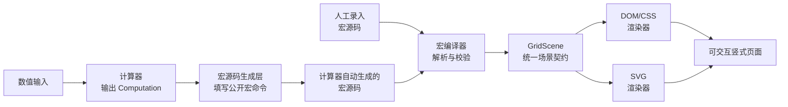

# @u1in/shushi-core

[](https://www.npmjs.com/package/@u1in/shushi-core)
[](https://www.npmjs.com/package/@u1in/shushi-core)
[](https://github.com/u1in/shushi/stargazers)
[](https://github.com/u1in/shushi/issues)
[](https://github.com/u1in/shushi/blob/main/LICENSE)
[](https://github.com/u1in/shushi/actions/workflows/deploy-pages.yml)

把竖式计算过程接入网页或 Node.js 应用：输入运算数据，得到可编辑的宏源码，编译为统一的 `GridScene`，再渲染为 DOM/CSS 或 SVG。

> 人工录入和计算器自动填写的是同一种宏源码，并经过同一条编译链路得到竖式。

[在线主页](https://u1in.github.io/shushi/) · [在线文档](https://u1in.github.io/shushi/doc/)

## 安装

一般应用只需要安装统一入口 `@u1in/shushi-core`。它同时提供计算器、竖式布局、宏解析与编译、网格工具以及 DOM/SVG/SVG 字符串渲染器，并自带 TypeScript 类型声明。

### npm 安装

```bash
npm install @u1in/shushi-core
```

### Skill 安装

在目标项目中执行，安装到当前 Agent 环境：

```bash
npx skills add https://github.com/u1in/shushi/tree/main/skills/u1in-shushi -a codex -y
```

### AI 安装指令

将下面的指令复制到你的代码 Agent 对话框：

```text
请阅读并严格遵循 https://u1in.github.io/shushi/doc/agent-installation.md，按其中说明完成 @u1in/shushi-core 的安装与验证。
```

## 使用

### 源代码实现

通常只需要调用一个门户 API，就能把 `356 + 278` 计算、生成可编辑宏源码并显示为 DOM 竖式：

```ts
import {
  shushi,
} from '@u1in/shushi-core'
import '@u1in/shushi-core/style.css'

const host = document.querySelector('#result')
const { computation, source, rendered, inspection } = shushi({
  operation: 'addition',
  values: ['356', '278'],
  renderMode: 'div',
  el: host ?? undefined,
})

console.log(computation.sumDigits) // '634'
console.log(source) // 可保存、复制或交给宏编辑器继续修改
console.log(rendered) // HTMLElement；已自动挂载到 host
const updated = inspection.updateElementText('grid-element-id', '9')
console.log(updated.source) // AST 更新后的宏源码
```

`shushi` 会固定执行“计算 → 宏源码 → GridScene → 渲染”，并返回 `computation`、`source`、`scene`、`rendered` 和 `inspection`。`renderMode` 支持 `div`、`svg`、`svg-string`，省略时默认为 `svg-string`；`div` / `svg` 只适用于客户端 DOM，`svg-string` 可用于客户端和服务端。传入 `el` 时，客户端渲染结果会自动挂载到该元素下。

需要逐层检查、保存中间宏或实现高级定制时，也可以显式调用底层链路：

```ts
import { compileMacro, computeAddition, createAdditionMacroSource } from '@u1in/shushi-core'

const computation = computeAddition('356', '278')
const source = createAdditionMacroSource(computation)
const scene = compileMacro(source)
```

如果需要 SVG DOM，把渲染模式改为：

```ts
const { rendered } = shushi({
  operation: 'addition',
  values: ['356', '278'],
  renderMode: 'svg',
  el: document.querySelector('#result') ?? undefined,
})
```

服务端或 SSR 使用 `renderMode: 'svg-string'`，读取返回值中的 `rendered` 字符串即可。

### Skill 实现

安装 Skill 后，将下面的指令复制到你的代码 Agent：

```text
$u1in-shushi 请开始交互式竖式实现。
```

### AI 实现

将下面的指令复制到代码 Agent，并回答它开始实现前的确认问题：

```text
请阅读并严格遵循 https://u1in.github.io/shushi/doc/agent-capabilities.md，按其中流程完成本次实现。
```

## 选择合适的 API

| 需求 | 推荐链路 |
| --- | --- |
| 根据输入直接得到过程、可编辑宏和场景 | `shushi({ operation, ... })` |
| 只计算答案和过程 | `computeAddition`、`computeSubtraction`、`computeMultiplication`、`computeDivision`、`computeShortDivision` 或 `computeCompositeArithmetic` |
| 根据数值生成标准竖式 | `compute*` → `create*MacroSource` → `compileMacro` → `renderDomGrid` / `renderSvgGrid` / `renderSvgString` |
| 让用户继续编辑竖式 | 保留 `create*MacroSource` 返回的源码，修改后再次调用 `compileMacro` |
| 逐步展示计算过程 | 使用布局 API 的 `visibleStepCount`，每次生成新的宏源码和 `GridScene` |
| 按书写顺序组合加、减、乘 | `computeCompositeArithmetic` → `createCompositeArithmeticMacroSource` → `compileMacro` |
| 用户已经提供宏源码 | `parseMacro` / `formatMacro` / `createMacroAstInspection` → `compileMacro` |
| 做 OCR、文本比对或无障碍摘要 | `compileMacro` → `extractVisibleTextRows` |
| 测量网格或图元 | `resolveGridMetrics`、`getGridPositionRect`、`getGridElementRect` |

支持的运算包括：

- 加法：进位和逐列求和过程；
- 减法：借位过程、负数结果和逐列差值；
- 乘法：部分积、进位和逐步展示；
- 长除法：试商、部分被除数、乘积、减法线和余数；
- 短除法：质因数分解、公因数/公倍数以及 2–36 进制转换。
- 组合运算：按书写顺序串联加、减、乘；每一步保留对应单项竖式与播放过程。

### 组合加、减、乘竖式

组合表达式以书写顺序执行，不采用通常的乘法优先级。所有步骤会连续编排为**同一份**可编辑宏源码与同一个 `GridScene`；上一步结果直接复用为下一步第一操作数，不重复抄写。播放时，下一步的运算符和第二操作数会在上一步完成后的独立一步才出现。组合乘法会自动关闭十倍数快捷计算，并保留表达式中操作数的上下顺序。减法借位默认隐藏；需要教学标记时传入 `showBorrowSteps: true`。

```ts
import {
  compileMacro,
  computeCompositeArithmetic,
  createCompositeArithmeticMacroSource,
  getCompositeArithmeticStepCount,
} from '@u1in/shushi-core'

const computation = computeCompositeArithmetic('125 + 75 - 20 × 3')
const source = createCompositeArithmeticMacroSource(computation, {
  visibleStepCount: 4,
})
const scene = compileMacro(source)

console.log(computation.resultDigits) // '540'
console.log(getCompositeArithmeticStepCount(computation))
```

中间结果需要继续参与下一步时必须为非负整数；最后一步减法可以得到负数。这保证每段仍严格使用既有的小学竖式规则。

所有计算器页面的“复制宏命令”统一调用 `minifyMacroForCopy` API 生成最简形式：移除网页专属无障碍标签和页面语义样式，保留会影响当前可见网格的非默认设置；默认设置下导出内容不含 `KV`，可直接粘贴到宏实验的宏源码框继续编辑。

## 宏源码与 `GridScene`

如果输入不是数值，而是希望自己控制行列、对齐、文字和线条，可以直接编写宏源码：

```ts
import { compileMacro } from '@u1in/shushi-core'

const source = '3,5,6;+,[2,RB(1)],[7,RB(1)],8;LN;6,3,4;'
const scene = compileMacro(source)
```

`compileMacro` 只负责解析和编译，不计算加法，也不创建 DOM 或 SVG。返回的 `GridScene` 是计算/布局与渲染之间的稳定数据契约。

## 从计算到渲染

无论用户从数值输入开始，还是直接提供宏源码，最终都会汇聚到同一个 `GridScene`，再由应用选择 DOM/CSS 或 SVG 渲染器。下面的流程图展示了从输入到页面的完整链路：



应用不需要为 DOM 和 SVG 各维护一套运算或坐标逻辑；只需在最后选择渲染模式即可。计算规则属于计算器，排版规则属于宏源码生成层，渲染器只消费已经编译完成的 `GridScene`。

## 浏览器、SSR 与 CSS

- `compute*`、`create*MacroSource`、`parseMacro`、`compileMacro`、`extractVisibleTextRows` 等纯数据 API 可在 Node.js 或 SSR 中使用。
- `renderDomGrid` 和 `renderSvgGrid` 应在浏览器环境中调用；SSR 或 Node.js 脚本请使用不依赖 DOM 的 `renderSvgString`。
- 浏览器入口请导入 `@u1in/shushi-core/style.css`。它提供网格图元的定位、字体、线条、辅助网格和语义 token 默认样式。
- DOM 和 SVG 都消费同一个 `GridScene`，不要在渲染器中重新判断进位、借位、部分积、商或余数。

## 常用示例

### 切换 DOM 与 SVG

```ts
import {
  compileMacro,
  renderDomGrid,
  renderSvgGrid,
} from '@u1in/shushi-core'
import '@u1in/shushi-core/style.css'

const source = '3,5,6;+,[2,RB(1)],[7,RB(1)],8;LN;6,3,4;'
const scene = compileMacro(source)
const domStage = renderDomGrid(scene)
const svgStage = renderSvgGrid(scene)
```

DOM 适合交互页面、元素回查和播放控制；SVG 适合导出、截图和缩放展示。

### SSR 输出 SVG 字符串

`renderSvgString` 不创建 DOM，适合在 Node.js、SSR 和构建脚本中直接生成 SVG 字符串：

```ts
import { compileMacro, renderSvgString } from '@u1in/shushi-core'

const scene = compileMacro('3,5,6;+,[2,RB(1)],[7,RB(1)],8;LN;6,3,4;')
const svg = renderSvgString(scene)
```

`renderSvgGrid` 与 `renderSvgString` 共享同一棵无 DOM SVG 渲染树，因此相同 `GridScene` 的坐标、图层、属性和图元顺序一致。这里保证的是 SVG 语义和视觉结构一致，不保证浏览器重新序列化 DOM 后与 SSR 字符串逐字节相同；最终宿主还应加载同一份 `@u1in/shushi-core/style.css`。

### 获取视觉文本行

```ts
import { compileMacro, extractVisibleTextRows } from '@u1in/shushi-core'

const scene = compileMacro('3,5,6;+,[2,RB(1)],[7,RB(1)],8;LN;6,3,4;')
const rows = extractVisibleTextRows(scene)

console.log(rows)
// ['356', '+278', '11', '634']
```

### 处理超大整数

数值运算优先传入字符串，避免 JavaScript `number` 的精度损失：

```ts
const computation = computeAddition('12345678901234567890', '10')
```

长除法的参数顺序是 `computeDivision(divisor, dividend)`，除数不能为 `0`。短除法进制转换的目标进制范围是 `2` 到 `36`。

## 反馈与贡献

欢迎通过 [GitHub Issues](https://github.com/u1in/shushi/issues) 反馈 Bug、提出功能建议或补充使用场景。提交问题时请尽量附上：

- 可复现的输入数据或宏源码；
- 预期结果与实际结果；
- 使用的 Node.js、浏览器和包版本；
- 最小复现步骤或示例项目。

提交代码前，请确保计算规则、宏语法、布局契约或渲染行为的变更同步更新对应文档与测试，并运行：

```bash
npm run typecheck
npm run test
npm run build
```

提交说明使用 Conventional Commits 格式：`<type>(<scope>): <中文说明>`，例如：

```text
fix(renderers): 修复 SVG 竖式线条显示
```
